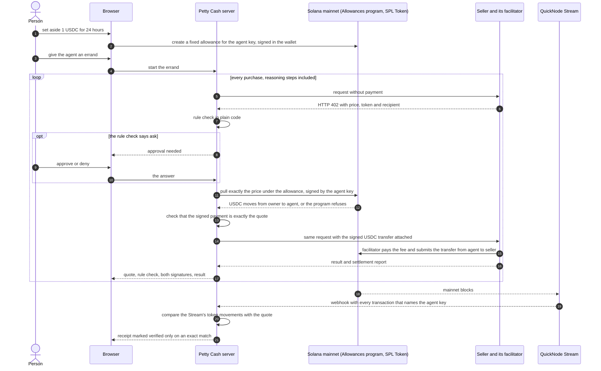

# Petty Cash

Petty Cash lets you set aside a small budget in your own Solana wallet for an AI agent: the agent pays real third-party sellers over x402 in real USDC on Solana mainnet, and Solana, not our server, refuses any spend above the budget.

University Blockchain Conference 2026 hackathon. Track: Agentic Payments and AI. Chain award: Best use of Solana. Bounty: Best Use of QuickNode Streams.

## Three things you can verify in a minute

1. **Solana enforces the budget.** The budget is an allowance account in Solana's audited Subscriptions and Allowances program, [`De1egAFMkMWZSN5rYXRj9CAdheBamobVNubTsi9avR44`](https://explorer.solana.com/address/De1egAFMkMWZSN5rYXRj9CAdheBamobVNubTsi9avR44). We deploy no program of our own. A pull above what is left fails with that program's error 300 (`amountExceedsLimit`). See rows 1 and 9 below.
2. **The agent pays real companies.** The catalog holds ten endpoints from nine third-party x402 sellers. The agent pays each one with a standard USDC transfer that the seller's own facilitator submits. Run `pnpm quotes` to ask all ten for a live mainnet price. On 2026-11-20 all ten answered. See rows 4 and 7.
3. **Receipts are checked against a QuickNode Stream, not against the agent's word.** A receipt is marked verified only when the Stream's own token-movement data shows that the owner paid exactly the quoted amount to the agent, and the agent paid exactly that amount of USDC to the quoted recipient. See rows 5 and 8.

## Evidence

Rows 1 to 6 and row 8 are done and reproducible today. The other rows are pending and say so. Every row is explained in [docs/EVIDENCE.md](docs/EVIDENCE.md).

| # | Claim | Result | Where |
|---|---|---|---|
| 1 | Our instruction builders work against the mainnet build of the Allowances program | 11 of 11 checks pass in a local validator: capped pull, over-limit pull refused (program error 300), wrong key refused (error 130), revoke, recurring period limit (error 400), expiry (error 128) | `scripts/verify-allowances-local.ts` |
| 2 | The purchase engine delivers, refunds and stops at every limit | 21 of 21 checks pass in a local rehearsal. The seller and the model in the rehearsal are test doubles. The payments really settle on the local chain | `scripts/rehearse-local.ts` |
| 3 | Automated tests | 140 pass without a database: 50 unit tests and 90 Stream pipeline tests | `pnpm test` |
| 4 | Every catalog seller is live on Solana mainnet | 10 of 10 endpoints answered an unpaid request with a USDC price, each naming its pinned recipient, on 2026-11-20 | `pnpm quotes` |
| 5 | The Stream filter reports what the chain recorded | Run in QuickNode's own sandbox on real mainnet blocks. Its token movements equal the balances `getTransaction` returns from a different RPC provider | [infra/quicknode/EVIDENCE.md](infra/quicknode/EVIDENCE.md) |
| 6 | The Allowances program is in real use | 22 fixed and 3,621 recurring allowance accounts on mainnet on 2026-11-20 | `getProgramAccounts` by account size, see [docs/EVIDENCE.md](docs/EVIDENCE.md) |
| 7 | A real paid purchase on Solana mainnet, real USDC | <!-- EVIDENCE:mainnet-purchase --> Pending: the pull and payment transaction signatures of one real purchase | |
| 8 | The live Stream delivers real mainnet payments to our deployed webhook | Done 2026-11-20. Stream `3a8caced-b74c-4171-a26c-dcd8a462d482` ran for two minutes with its filter pointed at a busy x402 facilitator's key. Three real payments by other buyers arrived at `/api/quicknode` 0.8 to 1.9 seconds after their block, passed the signature check and were stored with their exact token movements. The filter was then set back to our agent's key and the Stream paused | [docs/evidence/2026-11-20-stream-live-delivery-test.jsonl](docs/evidence/2026-11-20-stream-live-delivery-test.jsonl) |
| 8b | A live Stream delivery verifies our own purchase | <!-- EVIDENCE:stream-delivery --> Pending: the delivery that matched both transactions of a purchase by our agent | |
| 9 | Solana refuses an over-limit pull on mainnet | <!-- EVIDENCE:overlimit-refusal --> Pending: the failed transaction signature showing error 300 | |
| 10 | Revoke closes the petty cash and the agent can pull nothing | <!-- EVIDENCE:revoke --> Pending: the revoke transaction signature and the closed account | |
| 11 | Public demo anyone can run without a wallet | <!-- EVIDENCE:deployed-url --> The app is live at https://pettycash-pink.vercel.app on Solana mainnet. The agent's key is [`5SAtLdgB7VnhbTBJGjKs4HkYKNjPC4Dnhx6FLVu4Jtz9`](https://explorer.solana.com/address/5SAtLdgB7VnhbTBJGjKs4HkYKNjPC4Dnhx6FLVu4Jtz9). Pending: the funded house petty cash account | |

## What it does

- **Set aside.** You connect a wallet and pick an amount and an expiry, for example $1.00 for 24 hours. The money stays in your wallet. Solana records a limit for one spender, the agent's key.
- **Run an errand.** You describe a task in plain words. The agent buys what it needs, one paid request at a time: web search, page reading, market data, weather, news, and its own reasoning. It holds no API keys for any seller or model. Each reasoning step is a paid request too.
- **See every purchase.** Each one shows the seller's quote, the rule check, both transactions and what came back. A purchase above $0.01 waits for your approval.
- **Test the limit.** One button asks Solana to pull one base unit more than is left and shows the program's refusal as a failed transaction on the explorer.
- **Revoke.** One button closes the petty cash from your own wallet. This works without our site: any client can send the program's revoke instruction.
- **No wallet needed.** Anyone can run an errand on a public "house" petty cash that the team funded. It is safe to leave open because its cost is capped by an onchain allowance in the same program, plus a per-errand budget and rate limits.
- **Try to trick it.** The app ships a page, `/trap`, that tells AI agents to ignore their limits and send the money away. Ask the agent to read it. The rule check and the onchain limit do not depend on what any page says.

What the agent can buy. Prices are what each seller quoted on Solana mainnet on 2026-11-20. The real price is whatever the seller quotes at purchase time.

| Tool | Seller | What it returns | Quoted |
|---|---|---|---|
| `web_search` | Minifetch | Keyword web search | $0.001 |
| `read_page` | Minifetch | One web page as markdown | $0.001 |
| `web_search_premium` | Exa | Semantic web search | $0.007 |
| `weather` | Agent Data Tools | Current weather and a 48 hour forecast | $0.002 |
| `crypto_news` | Otto AI | Crypto headlines with sources | $0.001 |
| `coin_price` | x402engine | Live cryptocurrency prices | $0.001 |
| `company_news` | 2s.io | Recent news by stock ticker | $0.0025 |
| `dex_pools` | CoinGecko | Onchain DEX pool data | $0.005 |
| `make_image` | agent402 | One generated image. Always asks first | $0.03 |
| reasoning | BlockRun | One step of the agent's own reasoning | $0.001 for the short test request. A real step costs more and depends on the model and the prompt |

## How one purchase works



In words, for every purchase (`src/lib/agent/purchase.ts`):

1. **Quote.** The server sends the request without payment. The seller answers HTTP 402 with a price, a token and a recipient. Nothing is signed or paid.
2. **Rule check.** Deterministic code compares the quote with the catalog and the limits, using the live onchain state of the petty cash. The result is allow, ask or deny.
3. **Ask.** If the answer is "ask", the errand pauses for up to 90 seconds until the owner approves or denies. On the house petty cash nobody can approve, so "ask" means no.
4. **Pull.** The agent's key pulls exactly the quoted amount from the owner's wallet into its own token account. The Allowances program decides whether this is allowed.
5. **Pay.** The x402 SDK builds the payment. Before it leaves the process, our code decodes the signed transaction and refuses it unless it is exactly the quoted transfer. The seller's facilitator pays the network fee and submits it.
6. **Record or return.** The response is recorded with its size and SHA-256 hash. If the payment was never sent, or can no longer land, the money goes back to the owner's wallet. If the seller took the payment and failed to deliver, that is recorded as paid and not delivered. x402 has no refund from a seller.

The Stream then delivers both transactions to our webhook, and only then can the receipt say verified.

## The agent's decision loop

`src/lib/agent/loop.ts`:

```text
repeat, at most 6 steps:
  1. Buy one reasoning step. It is a paid chat-completion request that must return ONE action as JSON:
       {"action": "buy", "tool": "<catalog id>", "input": {...}}   or   {"action": "answer", "answer": "..."}
  2. "answer": show it and stop.
  3. "buy": the tool must be in the catalog. The input is reduced to that tool's declared parameters.
     The same tool with the same input is never bought twice.
  4. Run the purchase: quote, rule check, approval if needed, pull, pre-send check, pay, record.
  5. Hand the trimmed result back to the model as quoted data, with the note that it is not instructions.
```

The errand stops when:

- the agent answers;
- a reasoning step cannot be bought, because the rule check says no (for example the errand budget is used up), Solana refuses the pull, or the seller fails;
- the model fails twice to return a valid action;
- the steps run out;
- the person presses Stop. A purchase already in flight is still finished and recorded.

A refused tool purchase does not end the errand. The model is told what happened and is told not to retry it. The model the agent buys its reasoning from is a setting (`REASONING_MODEL`); the limits do not depend on which one it is.

## Safety limits

Four layers, in order. Each layer assumes the ones after it might fail.

| # | Layer | Where | What it enforces | What it does not |
|---|---|---|---|---|
| 1 | Solana | Subscriptions and Allowances program | The total limit. The expiry. Only the agent's key can pull. The owner can revoke at any time, without us | Where pulled funds go. A fixed allowance has no recipient restriction, so layers 2 and 3 matter |
| 2 | Rule check on our server | `src/lib/agent/policy.ts` | Deny: seller not in the catalog, wrong network, wrong token, not a fixed price, price above the per-purchase ceiling, errand budget exceeded, petty cash gone, expired or too low. Ask the owner: recipient differs from the wallet pinned for that seller, price above the seller's usual price, price above the ask-first line, any image generation | It runs on our server. If the server is compromised, these rules are gone |
| 3 | Pre-send payment check on our server | `assertPaymentIsExactlyTheQuote` in `src/lib/x402/client.ts` | The signed transaction must hold exactly one `TransferChecked` of the quoted amount and token, from the agent's own token account to the quoted recipient. Nothing else is allowed except compute-budget and memo instructions. No address lookup tables. The agent is never the fee payer. The x402 SDK's own per-payment ceiling is also set to the quoted amount | Same process as layer 2 |
| 4 | The model holds no key | `src/lib/agent/loop.ts` | The model never holds a key and never builds a transaction. It can only name a tool from the catalog. Tool results come back as data | A model can still spend the budget badly inside the limits |

Default limits (`src/lib/server/config.ts`):

| Limit | Default | Setting |
|---|---|---|
| Total budget and expiry | Chosen by the owner, enforced onchain | Not a server setting |
| Ceiling for one purchase | $0.05 | `PER_PURCHASE_MAX_BASE` |
| Ask-first line | $0.01 | `APPROVAL_THRESHOLD_BASE` |
| Budget for one errand | $0.25 on your own petty cash, $0.03 on the house petty cash, never more than what is left | `RUN_BUDGET_BASE`, `HOUSE_RUN_BUDGET_BASE` |
| Steps in one errand | 6 | `MAX_STEPS` |
| Time to answer an approval | 90 seconds, then the answer is no | `APPROVAL_WAIT_MS` |
| House demo rate | 4 errands per hour per IP address, 40 per hour in total | `HOUSE_RUNS_PER_HOUR_PER_IP`, `HOUSE_RUNS_PER_HOUR` |

The full threat model is in [docs/TRUST.md](docs/TRUST.md).

## How Solana is used

Petty Cash deploys no program. It uses these:

| Program or account | Address | Used for |
|---|---|---|
| Subscriptions and Allowances | `De1egAFMkMWZSN5rYXRj9CAdheBamobVNubTsi9avR44` | The budget: create, pull, revoke |
| SPL Token | `TokenkegQfeZyiNwAJbNbGKPFXCWuBvf9Ss623VQ5DA` | USDC `TransferChecked` for payments and refunds |
| Associated Token Account | `ATokenGPvbdGVxr1b2hvZbsiqW5xWH25efTNsLJA8knL` | The agent's USDC account, created if missing |
| Compute Budget | `ComputeBudget111111111111111111111111111111` | Compute limit and priority fee |
| SPL Memo | `MemoSq4gqABAXKb96qnH8TysNcWxMyWCqXgDLGmfcHr` | The memo in each x402 payment. We use it to find the payment onchain |
| USDC mint | `EPjFWdd5AufqSSqeM2qN1xzybapC8G4wEGGkZwyTDt1v` | The only token accepted |

The x402 network id is `solana:5eykt4UsFv8P8NJdTREpY1vzqKqZKvdp`.

- **The budget is an account, not a transfer.** A one-time setup instruction makes a program-derived account (seeds `"SubscriptionAuthority"`, wallet, mint) the delegate of the owner's USDC token account. A second instruction creates the allowance account (seeds `"delegation"`, that authority, owner, agent, nonce) holding the amount and the expiry. The USDC stays in the owner's wallet until a pull.
- **Every purchase is two mainnet transactions.** The pull is the program's transfer instruction for a fixed allowance (instruction 4, or 5 for a recurring allowance), signed by the agent's key. The payment is an SPL Token `TransferChecked` from the agent to the seller, signed by the agent and submitted by the seller's facilitator.
- **Who pays the network fees.** The owner pays for setup, set-aside and revoke. The agent's key pays for pulls, refunds and limit tests. The seller's facilitator pays for the payment: our pre-send check refuses a payment in which the agent would be the fee payer.
- **The limit test is a real failed transaction.** The server sends a pull for one base unit more than is left, with preflight skipped, so the program's refusal is recorded onchain for anyone to open.
- **Revoke is the owner's own instruction.** It closes the allowance account. After that the program cannot even load it.
- **Sign-in is a signed message.** No transaction and no fee. It proves the wallet before an errand can spend from its petty cash.
- **Why Solana.** A purchase costs a fraction of a cent, so the network fee has to be smaller still. And the allowance program already gives a wallet a capped, expiring, revocable spender without moving funds into anyone's custody.

The petty cash you create in the interface is a fixed allowance. The server can also pull from a recurring allowance (a cap per period), which the team's operations script can create for the house petty cash. Instruction layouts follow the program's published interface, version 0.5.0, and are exercised against the mainnet binary by `scripts/verify-allowances-local.ts`.

About the word "audited": the program is published by the Solana Foundation at [github.com/solana-foundation/subscriptions](https://github.com/solana-foundation/subscriptions), and that repository states that it has been audited multiple times by Cantina. That is the program's audit, not ours. Petty Cash's own code has not been audited.

## The QuickNode Stream

The Stream is the only source that can mark a receipt verified. Its configuration is code: `scripts/stream.ts` creates it and `infra/quicknode/filter.js` is the filter.

| Setting | Value | Why |
|---|---|---|
| Network | `solana-mainnet` | Purchases are real USDC on Solana mainnet |
| Dataset | `block` | It carries, for every transaction, the token balances before and after, the fee payer, every instruction and the chain's own error. We tested `programs_with_logs` on the same block and rejected it: it lists only the balances after the transaction, so a change cannot be computed from it |
| Filter logic | Keep a transaction only if its account keys include the agent's public key, counting keys loaded from address lookup tables. For each match emit one compact object: signature, slot, block time, success and error, fee payer, programs invoked, Allowances instruction numbers, memos, and the net token change per owner wallet and mint. Return `null` when a block has no match, so nothing is delivered | Every pull, payment, refund and refused over-limit attempt names the agent's key. The net balance change per wallet is the one fact that proves who paid whom how much, whatever the instruction encoding |
| Destination | Webhook: `POST /api/quicknode` on the deployed app. HTTPS only, no compression, 3 retries, 10 second timeout, with a security token | Deliveries go straight into our database. Each one is authenticated with HMAC-SHA256 over nonce, timestamp and raw body, must be less than 5 minutes old, and its nonce is accepted once |
| Batching | `dataset_batch_size: 5` with elastic batching | QuickNode refuses a smaller batch for an open-ended mainnet stream. Elastic batching delivers blocks as soon as they exist |
| Range | Starts at the chain tip, no end block | We need new transactions quickly, not history |
| Region | `usa_east` | |
| Lifecycle | Created paused. An errand moves the start to the current tip and activates it. It is paused again after about 2 idle minutes | Billing is per processed block, so the Stream runs only while errands need it |

Why the Stream is a core data source and not decoration:

- `verified` is computed only from rows the webhook stored (`src/lib/server/receipts.ts`, `src/lib/stream/match.ts`). Nothing the agent, the seller or our own RPC reads say can set it.
- The rule is exact. The pull is verified only if the transaction succeeded, the owner's wallet lost exactly the quoted amount of USDC and the agent's wallet gained exactly that amount. The payment is verified only if the agent's wallet lost exactly that amount and the quoted recipient gained it. A receipt needs both.
- When a seller does not report which transaction paid it, the Stream finds it: the server looks for that exact movement, with the payment's memo, in the deliveries after the pull.
- A disagreement is shown, not hidden. The receipt says "Mismatch" with the reason, for example a different recipient or amount.
- If the Stream is not delivering, purchases still work and receipts stay at "Paid. Waiting for independent confirmation." They are never marked verified by another route.

Done so far: the filter was run in QuickNode's sandbox against real mainnet blocks, for a USDC payment, an Allowances pull, a failed transaction and a block with no match. The numbers are in [infra/quicknode/EVIDENCE.md](infra/quicknode/EVIDENCE.md). The live Stream has delivered real mainnet payments to the deployed webhook (row 8 of the evidence table). Its first delivery of a purchase by our own agent is row 8b, still pending.

## What is enforced where

| Guarantee | Enforced by | Holds if our server is compromised |
|---|---|---|
| The agent's key cannot pull more than what is left | Solana | Yes |
| Nothing can be pulled after the expiry | Solana | Yes |
| The owner can revoke at any time, with any client | Solana | Yes |
| No key other than the agent's can pull | Solana | Yes |
| Money goes only to approved sellers at their pinned wallets | Our server | No |
| Per-purchase ceiling, errand budget, ask first | Our server | No |
| The signed payment is exactly the quote | Our server, before sending | No |
| A receipt says verified only on an exact match with independent data | Our server, from QuickNode Stream data | The stamp is ours. The two explorer links on every receipt are not |

Worst case, stated plainly: if our server or the agent's key were compromised, an attacker could take what is left in the petty cashes set aside for this agent, and send it anywhere. Nothing else in the wallet is reachable, the loss is capped by the allowance, and the owner can revoke at any time.

## Prior art and what is different

The idea of an onchain allowance for an agent is not ours.

- Solana pitched it when the Subscriptions and Allowances program launched. The [announcement of 2 June 2026](https://solana.com/news/subscriptions-and-allowances) lists an autonomous agent with a defined budget among its uses.
- A public tutorial shows it: Chainstack's [Capped onchain budgets for AI agents](https://docs.chainstack.com/docs/solana-agent-allowances-x402), on devnet.
- An earlier project, BudgetRail (August 2026, [github.com/vignesh-chaturvedi/BudgetRail](https://github.com/vignesh-chaturvedi/BudgetRail)), built capped agent allowances for x402 on the same program, paying its own test merchant through a facilitator it runs itself.

What we add, as far as we could find:

- **It works against real third-party x402 sellers on mainnet, through their stock facilitators.** We pull just in time into the agent's account and pay with a standard transfer, so no seller has to change anything.
- **Receipts are verified from an independent data source**, a QuickNode Stream, and not from the agent's word.
- **The agent needs no API keys.** It pays per request, including for its own reasoning.
- **A public demo anyone can run** without a wallet.

## Limitations

- **Brief custody.** The agent's key holds the price of one purchase for the seconds between the pull and the payment, or for a few minutes when a payment's outcome is unclear and has to be settled. Because the program does not restrict where pulled funds go, a compromised server could send funds elsewhere. The loss is bounded by what is left in the allowance.
- **Server-side rules.** The seller allowlist, the pinned recipients and the per-purchase rules are enforced by our server, not by the chain.
- **A changed recipient is an "ask", not a hard no.** If a seller starts quoting a different wallet, the owner is asked and can approve it. On the house petty cash it is refused.
- **No refund from a seller.** If a seller takes the payment and fails to deliver, x402 gives no way to get it back. We record it as paid and not delivered.
- **Delivered means the seller answered.** We record the size and hash of what came back. We do not judge its quality.
- **Verification follows the Stream.** If the Stream is paused or late, a receipt stays unverified until the delivery arrives.
- **No professional audit.** Our code has had automated tests and AI-assisted review only.
- **Small amounts only.** The defaults and the interface are built for cents and single dollars.

## Run it yourself

Prerequisites: Node.js 22 and pnpm 10. For the local chain checks, the Solana CLI with `solana-test-validator` (we used 4.1.2). For the rehearsal and the app, a Postgres database.

```bash
pnpm install
pnpm test        # unit tests and Stream pipeline tests, no network needed
pnpm quotes      # asks every catalog seller for its price on mainnet; unpaid, nothing is signed
```

`pnpm test` runs 140 tests without a database. Seven more, for the storage of Stream deliveries, run only when `DATABASE_URL` is set.

Local chain checks. Terminal 1 starts a validator that loads the mainnet build of the Allowances program:

```bash
solana-test-validator --reset \
  --clone-upgradeable-program De1egAFMkMWZSN5rYXRj9CAdheBamobVNubTsi9avR44 \
  --url https://api.mainnet-beta.solana.com
```

Terminal 2:

```bash
pnpm tsx scripts/verify-allowances-local.ts   # 11 checks, needs only the validator
pnpm tsx scripts/rehearse-local.ts            # 21 checks, needs the validator and DATABASE_URL
```

`pnpm test:local` runs both. No real funds are involved: the token is a disposable local mint, the seller is a local test double that speaks the real x402 protocol, and the model is a scripted stand-in.

Database. `db/schema.sql` creates everything in its own `pettycash` schema. `ADMIN_DB_URL=... pnpm tsx scripts/db-setup.ts` applies it, creates a login role that can reach only that schema, and writes `DATABASE_URL` to `.env.local`. The script expects a hosted Postgres with a transaction pooler on port 6543. On a plain Postgres, apply `db/schema.sql` yourself and set `DATABASE_URL`.

The app:

```bash
pnpm dev                       # needs the required settings below in .env.local
NEXT_PUBLIC_MOCK=1 pnpm dev    # the interface alone, with scripted preview data and a banner that says so
```

Settings, by name. Server settings are read in `src/lib/server/config.ts` unless noted.

| Setting | Purpose |
|---|---|
| `AGENT_SECRET_KEY` | Required. The agent's key as a 64-byte JSON array. Fund it with a little SOL for pull fees |
| `DATABASE_URL` | Required. Postgres connection string |
| `SESSION_SECRET` | Required. Signs sign-in challenges and session cookies |
| `CLUSTER` | `mainnet-beta` (default) or `devnet` |
| `RPC_URLS` | Comma-separated RPC endpoints. Reads fail over, sends go to all |
| `AGENT_PUBLIC_KEY`, `USDC_MINT_OVERRIDE`, `X402_NETWORK_OVERRIDE`, `PRIORITY_MICROLAMPORTS` | Optional overrides |
| `PER_PURCHASE_MAX_BASE`, `APPROVAL_THRESHOLD_BASE`, `RUN_BUDGET_BASE`, `HOUSE_RUN_BUDGET_BASE`, `MAX_STEPS`, `APPROVAL_WAIT_MS` | Limits, in USDC base units where the name ends in `_BASE` |
| `HOUSE_OWNER`, `HOUSE_DELEGATION` | The house petty cash. Leave unset to switch the public demo off |
| `HOUSE_RUNS_PER_HOUR_PER_IP`, `HOUSE_RUNS_PER_HOUR` | Rate limits for the public demo |
| `REASONING_MODEL`, `HOUSE_REASONING_MODEL`, `REASONING_MAX_TOKENS` | Which model the agent buys its reasoning from, and how long a reply may be |
| `QUICKNODE_API_KEY`, `QN_STREAM_ID`, `QN_STREAM_SECURITY_TOKEN`, `STREAM_TIP_RPC_URL`, `STREAM_IDLE_MINUTES` | The Stream (`src/lib/stream/control.ts`, `src/app/api/quicknode/route.ts`, `src/lib/server/streamHooks.ts`) |
| `CRON_SECRET` | Shared secret for the housekeeping endpoint (`src/app/api/cron/tick/route.ts`) |
| `UNRESOLVED_WINDOW_MS`, `STALE_PULL_MS` | How long an unconfirmed payment is left alone before it is settled (`src/lib/agent/purchase.ts`) |

The Stream is managed with `pnpm stream <command>`: `create <webhookUrl>`, `get`, `list`, `activate`, `pause`, `set-url <webhookUrl>`, `set-filter`, `test-filter <slot>`, `delete`.

## Repository map

```text
src/lib/solana/allowances.ts   Allowances program: instruction builders, account addresses, account readers
src/lib/solana/cluster.ts      network ids, USDC mint, money formatting
src/lib/x402/client.ts         x402 buyer: unpaid quote, pre-send payment check, pay
src/lib/agent/catalog.ts       approved sellers, pinned recipients, usual prices
src/lib/agent/policy.ts        the rule check
src/lib/agent/purchase.ts      one purchase end to end, and settling unclear payments
src/lib/agent/loop.ts          the agent's decision loop
src/lib/server/                settings, agent wallet (pull, refund, limit test), RPC failover, sign-in, storage, receipts, errand runner
src/lib/stream/                Stream control, webhook authentication, the matching rule, delivery storage
infra/quicknode/filter.js      the Stream's filter function
infra/quicknode/EVIDENCE.md    the filter run against real mainnet blocks
src/app/api/                   HTTP routes
src/components/, src/lib/client/   the interface
db/schema.sql                  data model
scripts/                       local chain checks, rehearsal, seller quotes, database setup, Stream control, mainnet operations
tests/unit/, tests/stream/     automated tests
tests/local/seller.ts          the local x402 seller used by the rehearsal (a test double)
.github/workflows/             continuous integration, and the timer that calls the housekeeping endpoint
docs/                          architecture, threat model, evidence, submission text, video script
```

More detail: [docs/ARCHITECTURE.md](docs/ARCHITECTURE.md), [docs/TRUST.md](docs/TRUST.md), [docs/EVIDENCE.md](docs/EVIDENCE.md).

## What we would build next

- **Remove the brief custody.** Propose an x402 payment scheme in which the seller is paid straight from the owner's wallet under the allowance. The agent's key would then never hold funds, and the recipient would be fixed inside the same transaction as the pull.
- **Recurring daily budgets in the interface.** The program already supports a cap per period, and our server already pulls from recurring allowances. The interface only creates fixed ones today.
- **An open delivery record per seller.** The interface already shows how many of our own purchases each seller delivered. Building that record only from Stream-verified receipts, and publishing it as open data, would let any agent see which sellers deliver.
- **A professional audit** of the server-side rule check and payment check before any larger amounts.

## License

MIT. See [LICENSE](LICENSE) and [THIRD_PARTY_NOTICES.md](THIRD_PARTY_NOTICES.md).
