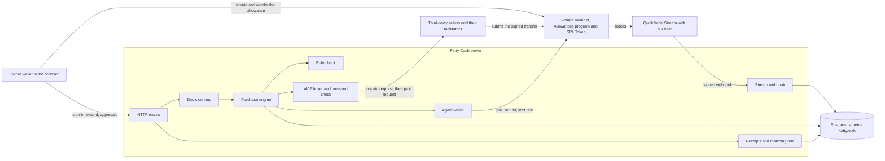
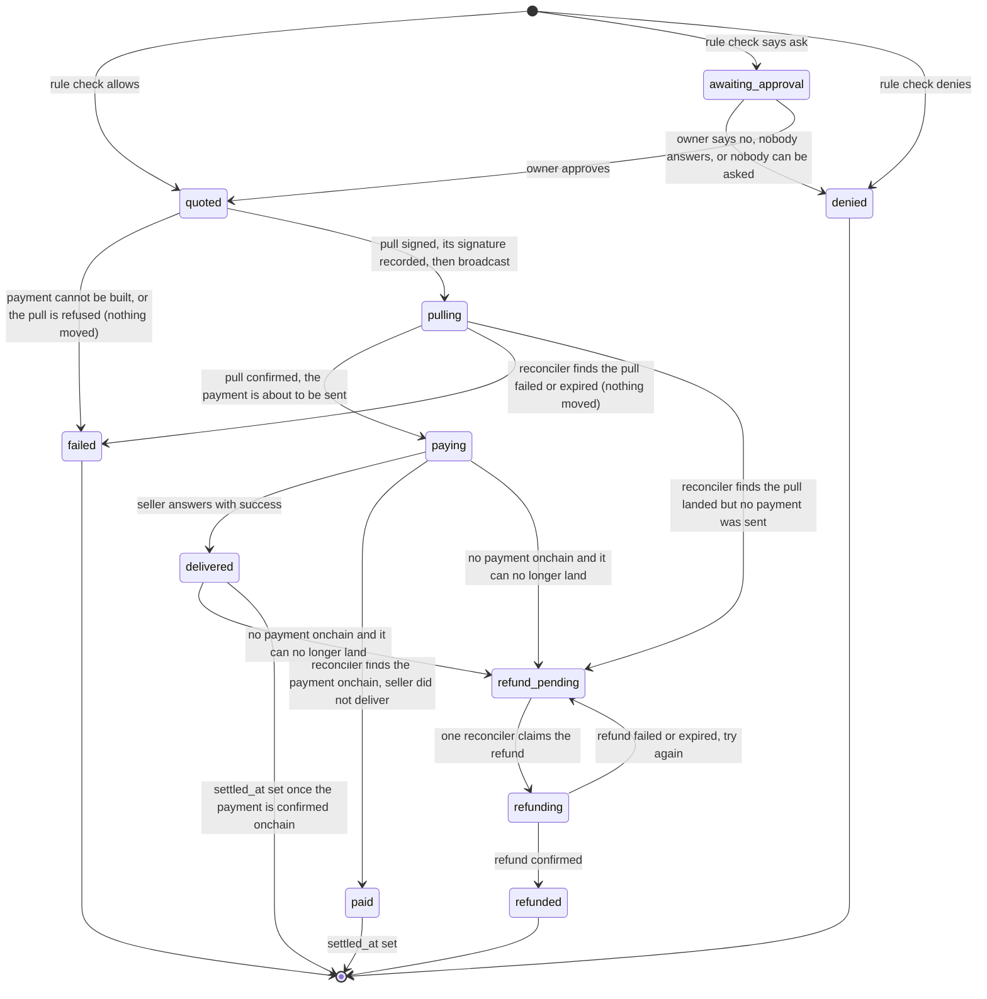

# Architecture

Petty Cash is one Next.js application, one Postgres schema, one agent key, one QuickNode Stream, and no onchain program of its own. This file describes the parts, the data model, the life of a purchase, the HTTP surface and the trust boundaries.

## Components

| Part | Code | Responsibility |
|---|---|---|
| Interface | `src/components/`, `src/lib/client/`, `src/app/page.tsx`, `src/app/r/[id]/page.tsx`, `src/app/trap/page.tsx` | Connect a wallet, set aside, run an errand, approve, test the limit, revoke, read receipts. Owner transactions are signed in the wallet and sent through the same-origin RPC proxy |
| Allowances client | `src/lib/solana/allowances.ts` | Instruction builders for the Subscriptions and Allowances program, derived addresses, account readers, error names |
| Agent wallet | `src/lib/server/agentWallet.ts` | The only code that uses the agent's key onchain: pull, refund, limit test. Reads allowance state from the chain |
| RPC | `src/lib/server/rpc.ts` | Reads fail over across endpoints. A signed transaction is simulated, broadcast to every endpoint and confirmed by polling |
| x402 buyer | `src/lib/x402/client.ts` | Unpaid quote, building the payment with the x402 SDK, the pre-send check, paying, reading the seller's settlement report |
| Rule check | `src/lib/agent/policy.ts` | Pure function from quote, catalog entry, limits and live state to allow, ask or deny |
| Catalog | `src/lib/agent/catalog.ts` | The approved sellers: host, pinned recipient wallet, usual price, declared parameters, how to build the request |
| Purchase engine | `src/lib/agent/purchase.ts` | One purchase from quote to record, and settling payments whose outcome was unclear |
| Decision loop | `src/lib/agent/loop.ts` | Buys reasoning steps, reads one action per step, runs purchases, stops |
| Errand runner | `src/lib/server/runner.ts` | Starts an errand, streams its events to the browser as newline-delimited JSON, stores every event, settles and rests the Stream afterwards |
| Sign-in | `src/lib/server/auth.ts` | Wallet proves itself by signing a challenge. The server sets a signed, HttpOnly session cookie for 12 hours |
| Stream | `infra/quicknode/filter.js`, `src/lib/stream/`, `src/app/api/quicknode/route.ts`, `scripts/stream.ts` | The filter, webhook authentication, storage of deliveries, the matching rule, switching the Stream on and off |
| Receipts | `src/lib/server/receipts.ts` | Joins purchases with Stream deliveries and computes `verified` and `mismatch` |
| Storage | `src/lib/server/store.ts`, `src/lib/stream/store.ts`, `db/schema.sql` | Errands, events, purchases, approvals, deliveries, rate limits, settings |

An errand is not tied to the browser connection. Once money may be in flight, the server finishes the purchase and the bookkeeping even if the tab is closed. Only a new step is skipped.

## Data model

Everything lives in the Postgres schema `pettycash` (`db/schema.sql`). The application connects with a role that can reach only that schema (`scripts/db-setup.ts`). No key or secret is stored in the database.

| Table | One row is | Notable columns |
|---|---|---|
| `runs` | One errand | `owner`, `delegation` (the allowance account), `cluster`, `task`, `status` (`running`, `awaiting_approval`, `done`, `failed`, `stopped`), `answer`, `spent_base`, `model`, `is_house` |
| `events` | One step of an errand's timeline, in order | `run_id`, `seq`, `type`, `data`. A finished errand is replayed from these |
| `purchases` | One attempted purchase | `kind` (`tool` or `reasoning`), `tool_id`, `seller_url`, `seller_host`, `pay_to`, `mint`, `amount_base`, `quote` (the seller's offer as received), `policy` (every rule and its result), `status`, `pull_sig`, `pay_sig`, `refund_sig`, `pay_memo`, `unresolved_until`, `http_status`, `response_sha256`, `response_bytes`, `response_preview`, `error` |
| `stream_deliveries` | One transaction delivered by the QuickNode Stream | `signature`, `slot`, `block_time`, `ok`, `payload` (the filter's object: token movements, programs, fee payer, memos), `stream_id`, `received_at` |
| `webhook_nonces` | One accepted webhook delivery | `nonce`. The replay guard |
| `approvals` | The owner's answer to one ask | `purchase_id`, `decision` |
| `artifacts` | One delivered image | `purchase_id`, `content_type`, `bytes`. Stored only if the file signature is PNG, JPEG or WebP |
| `rate_limits` | One fixed-window counter | `key`, `count`, `window_start` |
| `settings` | One key and value | For example when the Stream was last needed |

Amounts are integers in token base units. USDC has 6 decimals, so `1000` is $0.001.

## The life of a purchase

The `status` column of `purchases` moves like this:

Money moves in exactly two places on the way out, and one on the way back:

- **Pull**, owner to agent. The agent's key signs the Allowances program's transfer instruction for exactly the quoted amount, plus a unique note. The transaction is simulated first. If the program refuses, the purchase ends as `failed` and nothing moved.
- **Payment**, agent to seller. The x402 SDK builds a transaction. `assertPaymentIsExactlyTheQuote` decodes it and refuses anything other than the one quoted `TransferChecked`. This happens **before** the pull, so a payment that cannot be built never causes money to move. The seller's facilitator pays the fee and submits it.
- **Refund**, agent to owner. A `TransferChecked` from the agent's token account back to the owner's, plus a unique note.

Every pull and refund carries a unique note (`pettycash:pull:<purchase id>`), because two transactions with identical instructions and the same recent blockhash share one signature and the chain runs them once.

### Unresolved payments

Nothing here trusts a seller's word about money. `settleUnresolved` in `src/lib/agent/purchase.ts` settles every purchase whose money is not yet accounted for (`pull_sig` set, `settled_at` and `refund_sig` empty). It runs after every errand, again about 90 seconds later, and from the housekeeping endpoint.

What is written down, and when:

| Before this is broadcast | This is already in the database |
|---|---|
| The pull | its signature, its last valid block height, the payment's memo and blockhash, and `pay_last_valid_height`: the current block height plus 300 at the moment the payment was built |
| A refund | its signature and its last valid block height |

So a purchase interrupted at any point (the server stopped, an RPC call timed out) can be settled later from chain state alone.

How each open state is decided:

| State | Evidence looked at | Result |
|---|---|---|
| `pulling` | The pull's signature status, with history search | Landed: no payment was sent, so the money is returned. Failed, or a finalized block is past its last valid height: nothing moved |
| `paying`, `delivered`, `paid` | The agent token account's transactions since the pull, read back until the pull itself appears. A candidate must carry the payment's memo exactly, must not belong to another purchase, and must show the agent's balance falling by the amount and the pinned recipient's rising by it | Found: `settled_at` is set (and `paying` becomes `paid`). Not found and a finalized block is past `pay_last_valid_height`: the money is returned. Otherwise wait |
| `refund_pending` | none needed | One reconciler claims it and sends the refund |
| `refunding` | The recorded refund signature's status | Landed: `refunded`. Failed or expired: back to `refund_pending`. Unknown: wait. A refund is never blindly sent a second time |

The rules that keep this safe:

- **Never refund on a guess.** If the history read does not reach the pull (a node has pruned it), the answer is "unknown" and nothing is refunded.
- **Expiry is a block height, not a question about a blockhash.** At finalized commitment a brand-new blockhash is reported invalid exactly like an expired one. We therefore compare the finalized block height with a height recorded when the payment was built.
- **Exactly once.** Every state change is a compare-and-set on the current status (`moveStatus`), a refund needs an exclusive claim (`claimRefund`), and unique indexes stop one signature being recorded for two purchases.
- **A seller that takes the payment and fails keeps it.** That is recorded as `paid`, not delivered. x402 has no refund from a seller.

The rehearsal covers each branch with a seller that misbehaves on purpose: checks B, C, C2, L, M, R1 and R2 in `scripts/rehearse-local.ts`.

### How a receipt becomes verified

`toReceipts` in `src/lib/server/receipts.ts` loads the Stream deliveries for a purchase's two signatures and applies `checkReceipt` from `src/lib/stream/match.ts`:

- **Pull**: the transaction succeeded, the owner's wallet lost exactly `amount_base` of the mint, and the agent's wallet gained exactly that.
- **Payment**: the transaction succeeded, the agent's wallet lost exactly `amount_base`, and the wallet in `pay_to` gained exactly that.

`verified` is true only when both hold. If the Stream delivered a transaction and the numbers disagree, `mismatch` holds a plain reason. If the Stream has not delivered a transaction, the receipt is neither verified nor a mismatch.

When the seller did not report a payment signature, `findPaymentProof` searches the deliveries after the pull's slot for a successful transaction with exactly that movement and that memo, which is not already the payment of another purchase.

## HTTP surface

| Route | Who can call it | What it does |
|---|---|---|
| `GET /api/config` | Anyone | Network, USDC mint, agent address, program address, limits, house petty cash state, Stream state, catalog with each seller's delivered count |
| `GET /api/allowance?owner=` | Anyone | Chain state for a wallet: balances, whether setup is done, its petty cashes for this agent |
| `POST /api/auth/challenge`, `POST /api/auth/verify`, `GET /api/auth/me`, `POST /api/auth/logout` | Anyone | Wallet sign-in by signed message |
| `POST /api/run` | Signed-in owner | Starts an errand on the owner's petty cash. Checks that the allowance belongs to the session wallet, names this agent and USDC, is not expired or empty. One errand at a time per wallet, 30 per hour. Optional `runBudgetBase` and `approvalThresholdBase` can only tighten the limits. Answers with a stream of events |
| `POST /api/house/run` | Anyone | Starts an errand on the house petty cash. Rate limited. "Ask" means no |
| `POST /api/run/:id/approve` | The errand's owner | Approves or denies one waiting purchase |
| `GET /api/runs/:id` | Anyone for house errands, the owner for their own | Timeline and receipts of one errand |
| `GET /api/receipts?owner=&limit=` | Anyone | Receipts for a wallet |
| `GET /api/feed` | Anyone | The 12 most recent house receipts |
| `GET /api/artifact/:id` | Anyone with the purchase id | A delivered image, served with `nosniff` and a locked-down content security policy |
| `POST /api/prove/overspend` | Anyone | The limit test for a petty cash of this agent. Simulated, or sent so the refusal is recorded onchain. Sent tests are limited to 6 per hour per IP address and 60 per hour in total |
| `POST /api/rpc` | Anyone | Same-origin JSON-RPC proxy for the browser. A fixed list of methods, 240 requests per minute per IP address |
| `POST /api/quicknode` | QuickNode | The Stream webhook. Rejects with 401 before touching the database unless the HMAC, timestamp and nonce are valid |
| `GET /api/quicknode` | Anyone | Health: whether the webhook is configured, delivery count, last slot. No secrets |
| `GET /api/cron/tick` | Holder of `CRON_SECRET` | Housekeeping: settle unresolved purchases, pause the Stream when idle |

Every state-changing route from the browser refuses a foreign `Origin`.

What is public and what is private: receipts are public by wallet address, because everything in them is public chain data plus the seller and price. The text of an errand and its answer are private to the owner, unless the errand ran on the house petty cash, in which case the whole errand is public at `/r/<id>`.

Events on the errand stream (`RunEvent` in `src/lib/types.ts`): `run_started`, `thinking`, `quote`, `policy`, `approval_needed`, `approval_result`, `pulled`, `chain_refused`, `paid`, `delivered`, `purchase_failed`, `answer`, `run_finished`, `error`.

## The Stream pipeline

1. `scripts/stream.ts create <webhookUrl>` creates the Stream paused: network `solana-mainnet`, dataset `block`, the filter from `infra/quicknode/filter.js` with the agent's key in place, batch size 5 with elastic batching, starting at the chain tip with no end, destination webhook with a random security token.
2. When an errand starts, `ensureStreamActive` records that the Stream is needed, and if it is not running, moves its start to the current mainnet tip and activates it. Moving the start first means a stopped Stream never replays, and bills for, the blocks it missed. The tip is trusted only from an RPC that reports the mainnet genesis hash.
3. QuickNode runs the filter on each batch of blocks and posts the result when a transaction names the agent's key.
4. `POST /api/quicknode` authenticates the delivery (`x-qn-signature` is HMAC-SHA256 of nonce, timestamp and raw body with the security token; the timestamp must be within 5 minutes), then claims the nonce and stores the transactions in one statement. A failed write consumes nothing, so QuickNode's retry is processed. A transaction delivered twice is stored once.
5. Receipts read the stored deliveries, as described above.
6. `pauseStreamIfIdle` pauses the Stream after 4 minutes with no errand. If an errand arrives during the pause, the Stream is switched back on from the slot where it paused, so no block of that errand is skipped.

The control code changes only the stream named `pettycash-mainnet`, whatever id is configured.

## Trust boundaries

| Boundary | What crosses it | What is checked |
|---|---|---|
| Browser to server | Errands, approvals, sign-in | Wallet signature on a server-issued challenge, session cookie, same-origin check, ownership of the allowance read from the chain |
| Wallet to Solana | Setup, create and revoke transactions | Signed by the owner in their own wallet. The server never sees the owner's key |
| Server to Solana | Pulls, refunds, limit tests | Signed by the agent's key. The Allowances program checks every pull |
| Server to seller | Unpaid request, then the request with a signed payment | The quote is treated as untrusted input: rule check, then the pre-send check on the signed transaction. Redirects are refused. Response bodies are capped |
| Seller's facilitator to Solana | The payment transaction | We do not control it. It can only submit what the agent signed, which is exactly the quoted transfer |
| Model to server | One JSON action per step | Parsed strictly. Only a catalog tool id and that tool's declared text parameters are used |
| Tool results to model | Text from the internet | Trimmed, wrapped as data, never executed. Limits do not depend on the model obeying |
| QuickNode to server | Stream deliveries | HMAC, timestamp window, nonce, strict validation of every field the verification relies on |
| Server to database | All records | A role limited to one schema. No keys in the database |

Secrets held by the server: the agent's key, the session secret, the database URL, the QuickNode API key and Stream security token, and the housekeeping secret. The agent holds no API key for any seller or model.

The threat model built on these boundaries is in [TRUST.md](TRUST.md).
